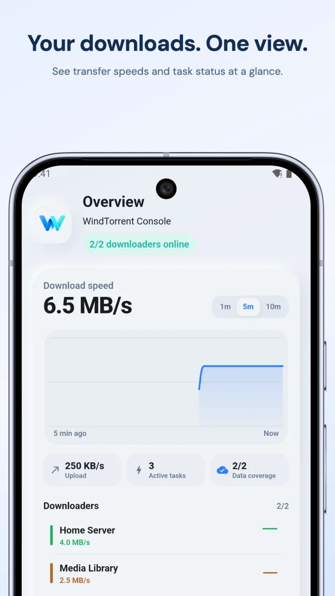
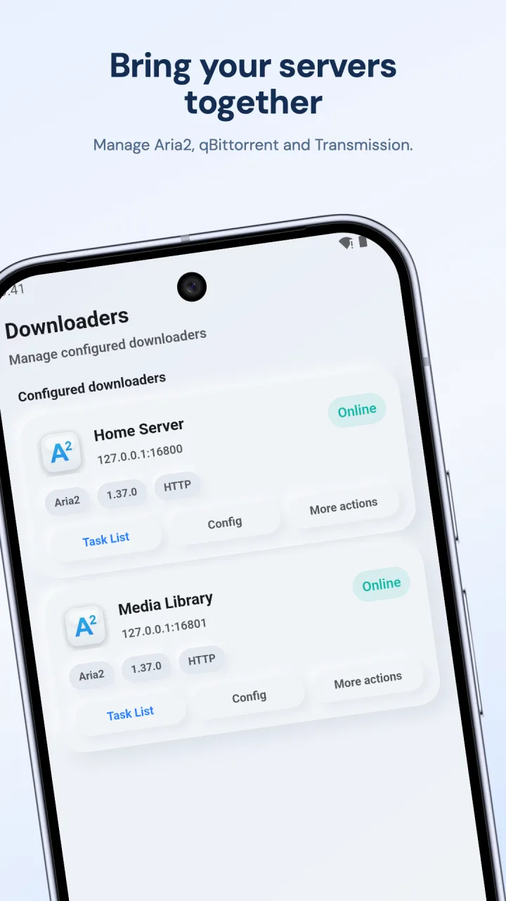
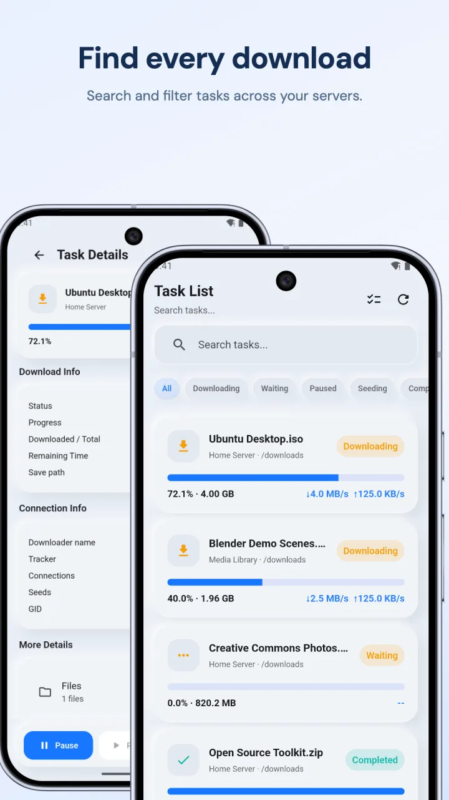
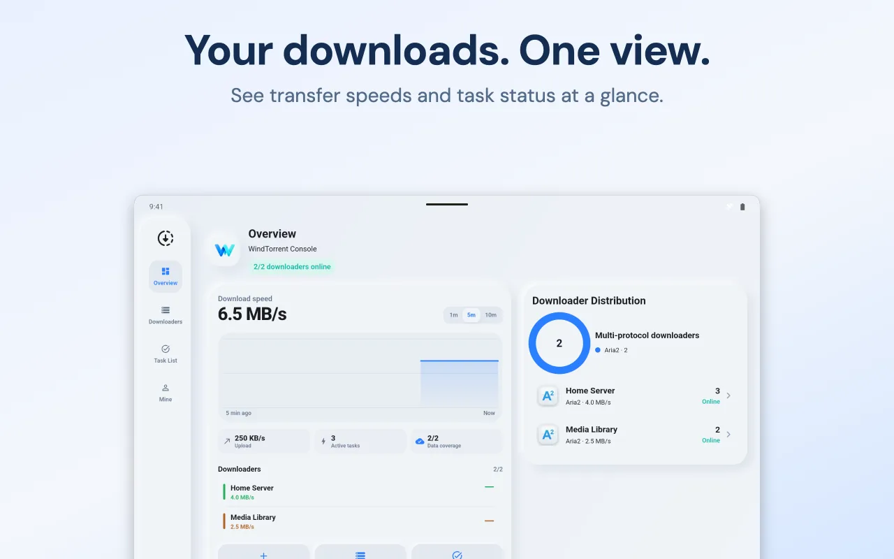

  

<h1 align="center">WindTorrent</h1>

<strong>Deine Downloader. Eine Android-App.</strong>

Verwalte Aria2, qBittorrent und Transmission von deinem Smartphone aus.

  <a href="https://play.google.com/store/apps/details?id=com.hienao.windtorrent">Bei Google Play herunterladen</a> ·
  <a href="https://hienao-apps.pages.dev/windtorrent/">Website</a>

<a href="README.md">English</a> · <a href="README.zh-CN.md">简体中文</a> · <a href="README.ja.md">日本語</a> · Deutsch 
  <a href="README.es.md">Español</a> · <a href="README.fr.md">Français</a> · <a href="README.pt-BR.md">Português (Brasil)</a> · <a href="README.ru.md">Русский</a>

WindTorrent verbindet sich mit Downloadern, die bereits auf deinem NAS, Server oder Computer laufen. Prüfe den Fortschritt, füge Aufgaben hinzu und pausiere oder starte Downloads an einem Ort. Die Dateien werden vom verbundenen Downloader heruntergeladen und auf dessen Gerät gespeichert.

  
  
  

Offizielle englische Google-Play-Vorschaubilder. Zum Vergrößern anklicken; die installierte Version kann anders aussehen.

## Weniger wechseln, einfacher verwalten

- **Alle Downloader zusammen.** Verbinde mehrere Instanzen von Aria2, qBittorrent und Transmission.
- **Behalte den Überblick.** Sieh Status, Fortschritt sowie Download- und Uploadgeschwindigkeit deiner Aufgaben.
- **Erledige alltägliche Aufgaben.** Füge Links oder Torrent-Dateien hinzu und pausiere, setze fort oder entferne Aufgaben. Die unterstützten Eingaben hängen vom Downloader ab.
- **Schau bei Bedarf genauer hin.** Prüfe Aufgabendetails und, je nach Downloader, Dateien, Tracker, Peers und Optionen.
- **Passe die App an.** Wähle Design und Sprache und übertrage Downloader-Einstellungen per lokalem JSON-Export und -Import.

## Verbindung herstellen

1. Installiere [WindTorrent](https://play.google.com/store/apps/details?id=com.hienao.windtorrent).
2. Aktiviere die Fernzugriffsschnittstelle deines Downloaders und prüfe, ob dein Smartphone sie erreichen kann.
3. Öffne **Downloaders**, tippe auf **+**, wähle den Typ und gib Host, Port und Zugangsdaten ein. Stelle HTTPS passend zum Server ein und speichere.

| Downloader | Fernzugriff | Üblicher Port | Anleitung auf Englisch |
| --- | --- | --- | --- |
| Aria2 | JSON-RPC | `6800` | [Aria2 verbinden](docs/aria2.md) |
| qBittorrent | WebUI API | `8080` | [qBittorrent verbinden](docs/qbittorrent.md) |
| Transmission | RPC | `9091` | [Transmission verbinden](docs/transmission.md) |

Verwende den tatsächlich erreichbaren Port, einschließlich einer möglichen Docker-Portzuordnung. Trage nur einen Hostnamen oder eine IP-Adresse in das Adressfeld ein; die App ergänzt den API-Pfad automatisch. Hinweise zu Reverse-Proxys findest du in den Anleitungen.

## Werbung und Käufe

WindTorrent ist eine einzelne App mit kostenloser Download-Verwaltung. Optional bieten ein einmaliger In-App-Kauf oder ein Jahresabo werbefreien Zugriff. Die App enthält das Werbe-SDK und verwendet Firebase Analytics; siehe die [Datenschutzerklärung (Englisch und Chinesisch)](https://hienao-apps.pages.dev/windtorrent/privacy/).

## Sprachen und Hilfe

Die App-Oberfläche ist auf Englisch, vereinfachtem Chinesisch und Japanisch verfügbar. Die Vorstellung in diesem Repository gibt es in acht Sprachen. Ausführliche Anleitungen und FAQ sind auf [Englisch](docs/faq.md) und [vereinfachtem Chinesisch](docs/zh-CN/faq.md) verfügbar.

[Melde ein Problem](https://github.com/hienao/WindTorrent/issues/new?template=bug_report.yml) oder [schlage eine Funktion vor](https://github.com/hienao/WindTorrent/issues/new?template=feature_request.yml). Formulare, [Hinweise zur Mitarbeit](CONTRIBUTING.md) und [Versionshinweise](CHANGELOG.md) sind auf Englisch und Chinesisch verfügbar.

Entferne vor dem Teilen von Screenshots oder Protokollen Passwörter, RPC-Schlüssel, private URLs und persönliche Aufgabendaten. Backups enthalten Zugangsdaten und gehören nicht in öffentliche Issues. Sensible Anliegen kannst du [per E-Mail](mailto:shiwentao666@gmail.com) melden.

## Über dieses Repository

Dies ist das offizielle öffentliche Repository für Dokumentation und Feedback zu WindTorrent. Die App ist Closed Source; ihr Quellcode ist hier nicht enthalten. Aria2, qBittorrent und Transmission sind eigenständige Projekte und nicht mit WindTorrent verbunden.

[Website (Englisch/Chinesisch)](https://hienao-apps.pages.dev/windtorrent/) · [Datenschutz (Englisch/Chinesisch)](https://hienao-apps.pages.dev/windtorrent/privacy/) · [Support](mailto:shiwentao666@gmail.com)
