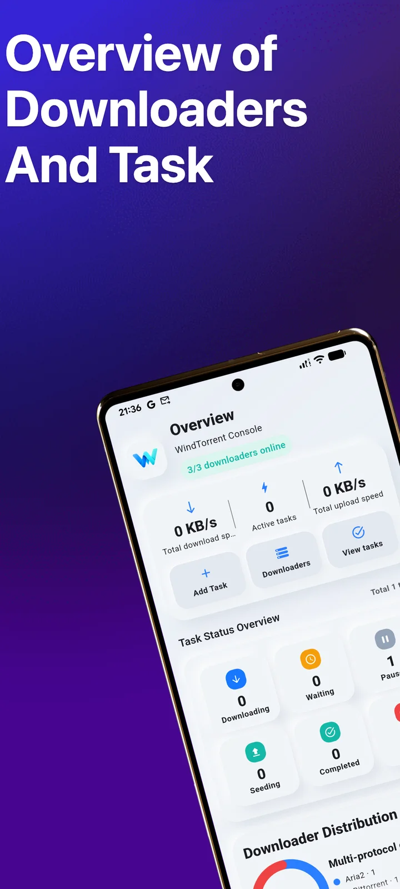
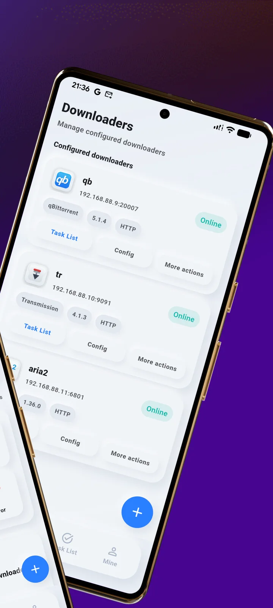
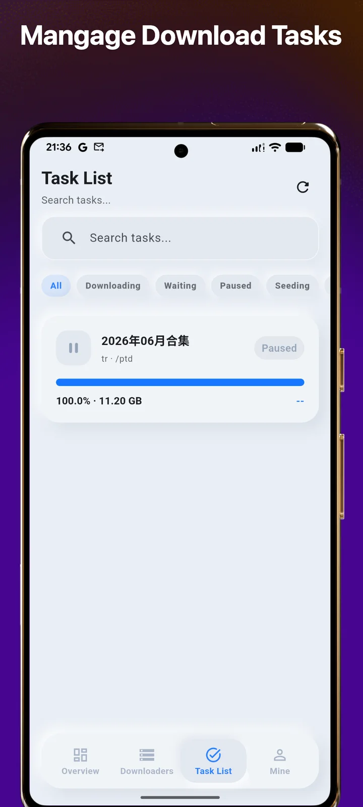

  

<h1 align="center">WindTorrent</h1>

<strong>Vos outils de téléchargement. Une seule application Android.</strong>

Gérez Aria2, qBittorrent et Transmission depuis votre téléphone.

  <a href="https://play.google.com/store/apps/details?id=com.hienao.windtorrent">Version gratuite sur Google Play</a> ·
  <a href="https://play.google.com/store/apps/details?id=com.hienao.windtorrent.pro">Obtenir Pro</a> ·
  <a href="https://hienao-apps.pages.dev/windtorrent/">Site officiel</a>

<a href="README.md">English</a> · <a href="README.zh-CN.md">简体中文</a> · <a href="README.ja.md">日本語</a> · <a href="README.de.md">Deutsch</a> 
  <a href="README.es.md">Español</a> · Français · <a href="README.pt-BR.md">Português (Brasil)</a> · <a href="README.ru.md">Русский</a>

WindTorrent se connecte aux outils de téléchargement que vous utilisez déjà sur un NAS, un serveur ou un ordinateur. Consultez leur progression, ajoutez des tâches et mettez vos téléchargements en pause ou reprenez-les au même endroit. Les fichiers sont téléchargés et enregistrés sur la machine qui exécute l’outil connecté.

  
  
  

Visuels officiels de Google Play en anglais. Cliquez pour les agrandir ; l’interface peut varier selon la version installée.

## Moins de changements d’application, plus de contrôle

- **Regroupez vos connexions.** Connectez plusieurs instances d’Aria2, de qBittorrent et de Transmission.
- **Suivez l’activité.** Consultez l’état, la progression et les vitesses de téléchargement et d’envoi.
- **Effectuez les opérations courantes.** Ajoutez des liens ou des fichiers torrent, puis mettez en pause, reprenez ou supprimez des tâches. Les formats acceptés dépendent de l’outil connecté.
- **Accédez aux détails utiles.** Consultez les détails des tâches et, selon les fonctions prises en charge, les fichiers, trackers, pairs et options.
- **Adaptez l’application à vos habitudes.** Choisissez le thème et la langue, et transférez vos paramètres par export et import JSON local.

## Se connecter

1. Installez [WindTorrent Free](https://play.google.com/store/apps/details?id=com.hienao.windtorrent) ou [WindTorrent Pro](https://play.google.com/store/apps/details?id=com.hienao.windtorrent.pro).
2. Activez l’interface de contrôle à distance de votre outil de téléchargement et vérifiez qu’elle est accessible depuis le téléphone.
3. Ouvrez **Downloaders**, touchez **+**, choisissez le type et saisissez l’hôte, le port et les identifiants. Réglez HTTPS selon la configuration du serveur, puis enregistrez.

| Outil | Interface distante | Port courant | Guide en anglais |
| --- | --- | --- | --- |
| Aria2 | JSON-RPC | `6800` | [Connecter Aria2](docs/aria2.md) |
| qBittorrent | WebUI API | `8080` | [Connecter qBittorrent](docs/qbittorrent.md) |
| Transmission | RPC | `9091` | [Connecter Transmission](docs/transmission.md) |

Utilisez le port réellement accessible, en tenant compte des éventuelles correspondances de ports Docker. Saisissez un nom d’hôte ou une adresse IP dans le champ d’adresse ; l’application ajoute automatiquement le chemin de l’API. Les guides précisent les exigences pour les proxys inverses.

## Free ou Pro ?

| | WindTorrent Free | WindTorrent Pro |
| --- | --- | --- |
| Fonctions principales de gestion | Incluses | Incluses |
| Publicité | Après sept jours de découverte, selon vos choix de confidentialité | Aucun SDK publicitaire |
| Achat | Installation gratuite | Application payante distincte |
| Installation | [Google Play](https://play.google.com/store/apps/details?id=com.hienao.windtorrent) | [Google Play](https://play.google.com/store/apps/details?id=com.hienao.windtorrent.pro) |

Les deux applications peuvent être installées ensemble. Les paramètres se transfèrent via un fichier JSON local. Pro s’achète séparément et ne constitue pas une mise à niveau par achat intégré dans Free. Les deux versions utilisent Firebase Analytics ; consultez la [politique de confidentialité en anglais et en chinois](https://hienao-apps.pages.dev/windtorrent/privacy/).

## Langues et assistance

L’interface de l’application est disponible en anglais, en chinois simplifié et en japonais. Ce dépôt propose une présentation en huit langues. Les guides détaillés et la FAQ sont disponibles en [anglais](docs/faq.md) et en [chinois simplifié](docs/zh-CN/faq.md).

[Signalez un problème](https://github.com/hienao/WindTorrent/issues/new?template=bug_report.yml) ou [proposez une fonctionnalité](https://github.com/hienao/WindTorrent/issues/new?template=feature_request.yml). Les formulaires, le [guide de contribution](CONTRIBUTING.md) et les [notes de version](CHANGELOG.md) sont en anglais et en chinois.

Avant de partager des captures ou des journaux, retirez les mots de passe, secrets RPC, URL privées et informations personnelles sur les tâches. Les sauvegardes contiennent des identifiants et ne doivent pas être jointes aux tickets publics. Pour un sujet sensible, contactez [l’assistance par e-mail](mailto:shiwentao666@gmail.com).

## À propos de ce dépôt

Ce dépôt public officiel rassemble la documentation et les retours sur WindTorrent. L’application est à code source fermé ; son code n’est pas distribué ici. Aria2, qBittorrent et Transmission sont des projets indépendants, sans affiliation avec WindTorrent.

[Site officiel (anglais/chinois)](https://hienao-apps.pages.dev/windtorrent/) · [Confidentialité (anglais/chinois)](https://hienao-apps.pages.dev/windtorrent/privacy/) · [Assistance](mailto:shiwentao666@gmail.com)
