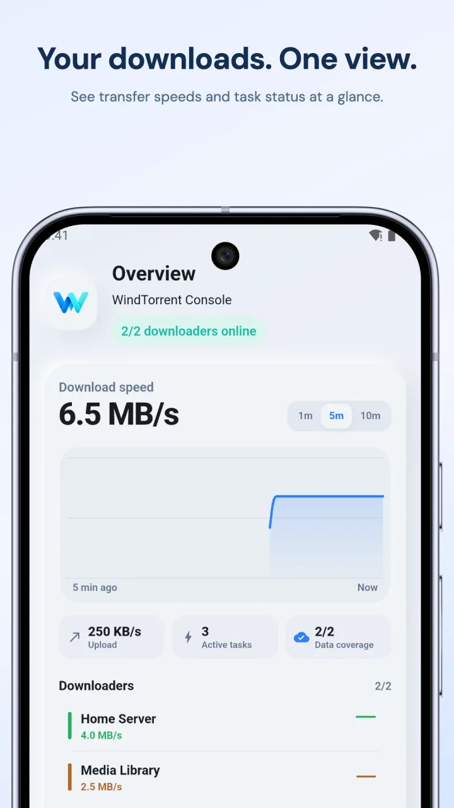
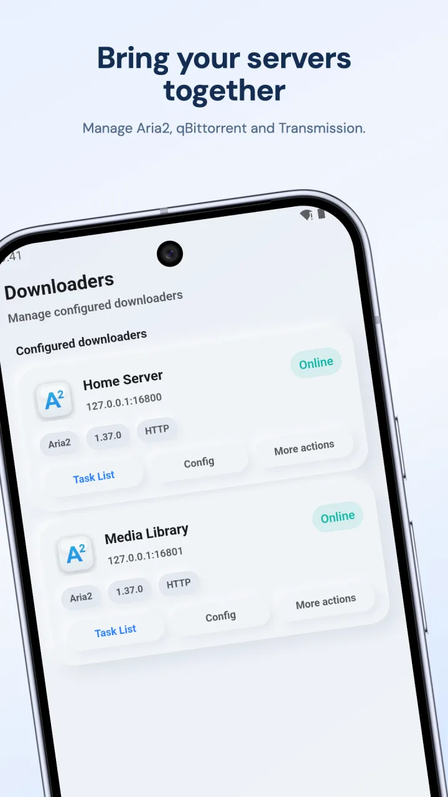
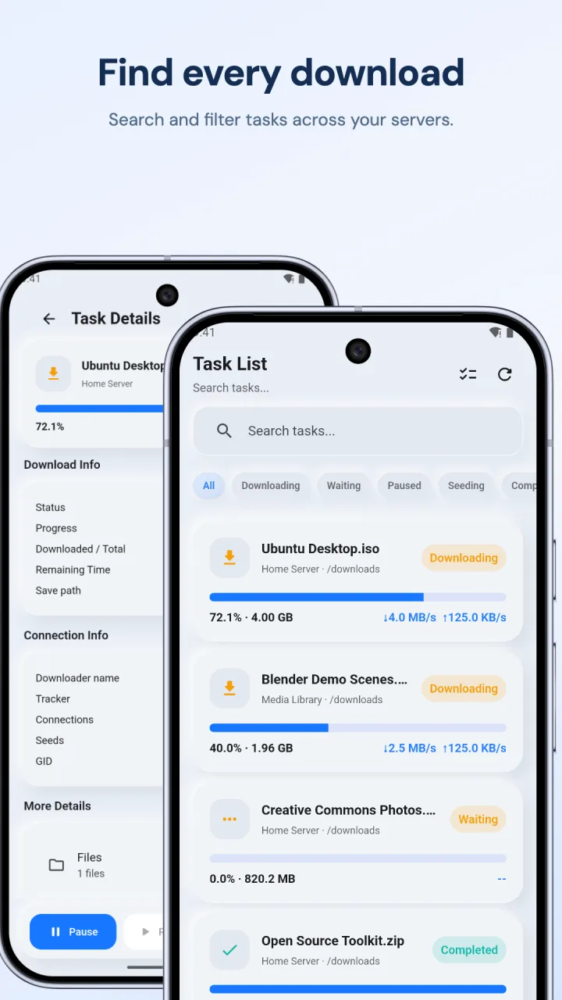
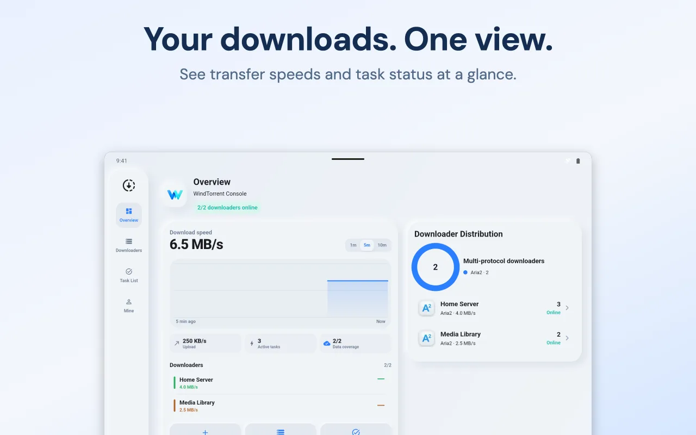

  

<h1 align="center">WindTorrent</h1>

<strong>Ваши загрузчики. Одно приложение для Android.</strong>

Управляйте Aria2, qBittorrent и Transmission с телефона.

  <a href="https://play.google.com/store/apps/details?id=com.hienao.windtorrent">Скачать в Google Play</a> ·
  <a href="https://hienao-apps.pages.dev/windtorrent/">Сайт</a>

<a href="README.md">English</a> · <a href="README.zh-CN.md">简体中文</a> · <a href="README.ja.md">日本語</a> · <a href="README.de.md">Deutsch</a> 
  <a href="README.es.md">Español</a> · <a href="README.fr.md">Français</a> · <a href="README.pt-BR.md">Português (Brasil)</a> · Русский

WindTorrent подключается к загрузчикам, которые уже работают на вашем NAS, сервере или компьютере. Проверяйте прогресс, добавляйте задания, приостанавливайте и возобновляйте загрузки в одном приложении. Файлы скачиваются и сохраняются на устройстве, где работает подключённый загрузчик.

  
  
  

Официальные изображения из Google Play на английском языке. Нажмите для увеличения; интерфейс установленной версии может отличаться.

## Меньше переключений, удобнее управление

- **Все загрузчики вместе.** Подключайте несколько экземпляров Aria2, qBittorrent и Transmission.
- **Следите за происходящим.** Проверяйте состояние заданий, прогресс, скорость скачивания и отдачи.
- **Выполняйте повседневные действия.** Добавляйте ссылки или торрент-файлы, приостанавливайте, возобновляйте и удаляйте задания. Допустимые форматы зависят от загрузчика.
- **Открывайте нужные подробности.** Просматривайте файлы, трекеры, пиры и параметры заданий, если загрузчик поддерживает соответствующие функции.
- **Настраивайте под себя.** Выбирайте тему и язык, переносите настройки загрузчиков с помощью локального экспорта и импорта JSON.

## Как подключиться

1. Установите [WindTorrent](https://play.google.com/store/apps/details?id=com.hienao.windtorrent).
2. Включите интерфейс удалённого управления загрузчика и убедитесь, что он доступен с телефона.
3. Откройте **Downloaders**, нажмите **+**, выберите тип и укажите адрес сервера, порт и данные для входа. Настройте переключатель HTTPS в соответствии с сервером и сохраните подключение.

| Загрузчик | Удалённый интерфейс | Обычный порт | Инструкция на английском |
| --- | --- | --- | --- |
| Aria2 | JSON-RPC | `6800` | [Подключение Aria2](docs/aria2.md) |
| qBittorrent | WebUI API | `8080` | [Подключение qBittorrent](docs/qbittorrent.md) |
| Transmission | RPC | `9091` | [Подключение Transmission](docs/transmission.md) |

Укажите фактически доступный порт с учётом проброса портов Docker. В поле адреса введите имя хоста или IP-адрес; приложение само добавит путь API. Требования к обратному прокси описаны в инструкциях.

## Реклама и покупки

WindTorrent — единое приложение с бесплатным управлением загрузками. Покупка внутри приложения или годовая подписка отключает рекламу. Приложение содержит рекламный SDK и использует Firebase Analytics; см. [политику конфиденциальности на английском и китайском](https://hienao-apps.pages.dev/windtorrent/privacy/).

## Языки и помощь

Интерфейс приложения доступен на английском, упрощённом китайском и японском языках. Описание в этом репозитории представлено на восьми языках. Подробные инструкции и ответы на частые вопросы доступны на [английском](docs/faq.md) и [упрощённом китайском](docs/zh-CN/faq.md).

[Сообщите об ошибке](https://github.com/hienao/WindTorrent/issues/new?template=bug_report.yml) или [предложите функцию](https://github.com/hienao/WindTorrent/issues/new?template=feature_request.yml). Формы, [правила участия](CONTRIBUTING.md) и [история изменений](CHANGELOG.md) доступны на английском и китайском языках.

Перед публикацией снимков экрана или журналов удалите пароли, секреты RPC, закрытые URL и личные сведения о заданиях. Резервные копии содержат данные для входа — не прикладывайте их к публичным обращениям. По вопросам с конфиденциальными данными пишите [в поддержку](mailto:shiwentao666@gmail.com).

## Об этом репозитории

Это официальный публичный репозиторий документации и обратной связи WindTorrent. Приложение имеет закрытый исходный код, который здесь не распространяется. Aria2, qBittorrent и Transmission — независимые проекты, не аффилированные с WindTorrent.

[Сайт (английский/китайский)](https://hienao-apps.pages.dev/windtorrent/) · [Конфиденциальность (английский/китайский)](https://hienao-apps.pages.dev/windtorrent/privacy/) · [Поддержка](mailto:shiwentao666@gmail.com)
